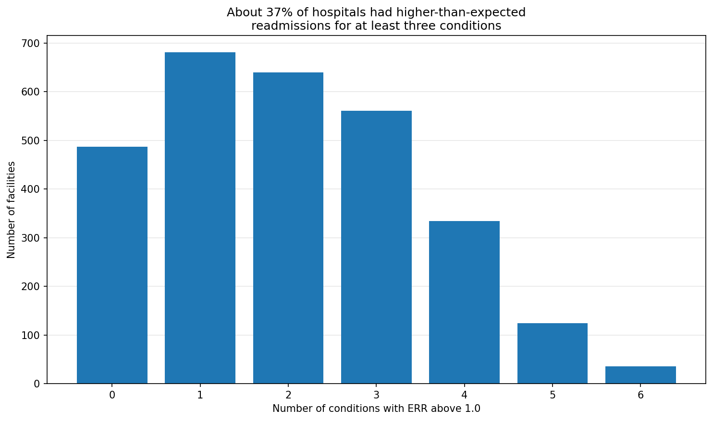
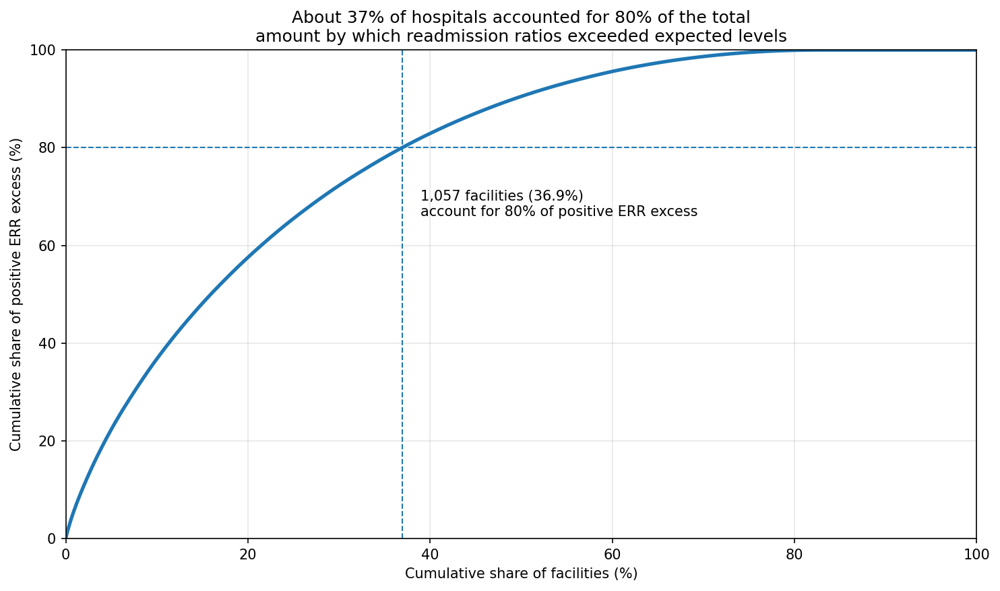

# Narrowing Facility Review to 1,057 Hospitals Accounting for 80% of Aggregate Positive ERR Excess

A Director of Quality Improvement must decide which hospitals to investigate first because the team cannot review every facility. This analysis uses Hospital Readmissions Reduction Program data to identify where above-expected Excess Readmission Ratio (ERR) performance is concentrated. It identifies 1,057 of 2,862 facilities that account for 80% of aggregate positive ERR excess.

The finding provides an initial review list of 1,057 facilities, a 63.07% reduction calculated from the original 2,862 facilities. This narrower list allows the team to focus its initial review on facilities contributing most of the aggregate positive ERR excess. The reduction describes the size of the review list, rather than a demonstrated reduction in readmissions or costs.

The analysis first compared Medical and Surgical condition groups, finding nearly identical mean ERR values and no statistically significant difference. It then shifted to facility-level analysis to identify a more focused starting point for review. The resulting list supports prioritization, while further investigation is needed to understand the clinical and operational causes of above-expected performance.

## Why HRRP Matters

The Hospital Readmissions Reduction Program is a Medicare value-based purchasing program that links hospital payment to readmission performance. CMS uses 30-day risk-standardized unplanned readmission measures for selected conditions and procedures and evaluates hospital performance using the **Excess Readmission Ratio (ERR)**.

Official CMS program information:  
https://www.cms.gov/medicare/quality/value-based-programs/hospital-readmissions

## Business Questions

This analysis focused on two questions:

1. **Do Medical and Surgical HRRP conditions show meaningfully different ERR patterns?**
2. **Is above-expected readmission performance disproportionately concentrated among a smaller group of facilities?**

The goal was not to identify the clinical cause of readmissions, but to determine whether the available CMS data could help narrow where a quality team should investigate first.

## Dataset and Scope

Source: CMS Hospital Readmissions Reduction Program data.

Official CMS dataset:  
https://data.cms.gov/provider-data/dataset/9n3s-kdb3

The source file used for this project contained:

- **18,510 hospital-condition records**
- **3,085 facilities**
- **6 HRRP conditions/procedures**
- **11,927 records with usable ERR values**
- **2,862 facilities with at least one usable ERR value**

The six HRRP measures in the dataset were:

- Acute Myocardial Infarction (AMI)
- Heart Failure (HF)
- Pneumonia (PN)
- Chronic Obstructive Pulmonary Disease (COPD)
- Coronary Artery Bypass Graft (CABG)
- Hip/Knee Replacement

AI use statement: AI helped plan the analysis and draft the condition mapping, Python code, and README explanations; I used AI assistance throughout rather than writing a separate portion independently, ran the code myself, and reviewed the outputs and AMI mapping validation checks with AI guidance; no non-public data was provided to any AI tool.

## Key Metric Definitions

### Excess Readmission Ratio (ERR)

ERR compares a hospital's predicted readmissions with the expected readmissions for a hospital treating similar patients.

- **ERR > 1.0:** readmissions were higher than expected
- **ERR = 1.0:** readmissions were approximately as expected
- **ERR < 1.0:** readmissions were lower than expected

### ERR Excess

To measure the **magnitude** of above-expected performance, I created a project-specific prioritization measure:

`ERR Excess = max(ERR - 1.0, 0)`

This gives records at or below 1.0 a value of zero and measures only how far above 1.0 an above-expected record falls.

**ERR Excess is not an official CMS penalty or financial measure.** It was created only to help identify whether above-expected ERR magnitude was concentrated among a subset of facilities.

## How I Verified

1. **Facility ID formatting:** I loaded `Facility ID` as a string to preserve leading zeros, then inspected its data type, sample values, and string lengths. The outputs confirmed string formatting, preserved an ID such as `010001`, and showed six-character IDs across all 18,510 records.

2. **Source dataset size and measure coverage:** I checked `df.shape`, counted unique facilities, and inspected measure frequencies. The outputs showed 18,510 records, 3,085 facilities, and six measures with 3,085 records each.

3. **Condition mapping coverage:** I compared the set of source measure names with the mapping keys using an `assert` statement. The assertion passed, confirming that the source measures and mapping keys matched exactly.

4. **Complete condition assignment:** After applying the mapping, I counted missing condition types and asserted that every record had an assignment. The check passed with zero unmapped records, 12,340 Medical records, and 6,170 Surgical records.

5. **Analytical dataset counts:** I counted nonmissing ERR values before filtering and printed record, facility, and condition-group counts afterward. The filtered dataset contained the expected 11,927 records across 2,862 facilities, with 9,456 Medical records, 2,471 Surgical records, and zero unmapped records.

**What went wrong and how I caught it:** An incorrect AMI mapping code left 1,763 usable AMI observations out of the Medical group; inconsistent condition-group counts led me to investigate, correct the mapping, and rerun the affected analysis.

## Data Quality Log

| Issue                                                                                                           | How I handled it                                                                                                                                                                      | Why it mattered                                                                                                             |
| --------------------------------------------------------------------------------------------------------------- | ------------------------------------------------------------------------------------------------------------------------------------------------------------------------------------- | --------------------------------------------------------------------------------------------------------------------------- |
| Facility IDs contain leading zeros and represent identifiers rather than measurements.                          | Loaded `Facility ID` as a string and confirmed its type, sample values, and six-character lengths.                                                                                    | Preserved the original identifier formatting used to group facilities.                                                      |
| The AMI mapping code did not match the source measure name, leaving 1,763 usable AMI observations unclassified. | Corrected the mapping, reran the affected analysis and statistical test, and added assertions for measure coverage and complete condition assignment.                                 | Restored the observations to the Medical group and prevented unmatched measures from silently passing through the workflow. |
| Some hospital-condition records had no reported ERR.                                                            | Used `dropna(subset=["Excess Readmission Ratio"]).copy()` to create a separate analytical dataset, retaining 11,927 of 18,510 records while leaving the original dataframe unchanged. | Records without ERR could not contribute to the ERR comparisons or facility-level calculations.                             |
| Filtering for usable ERR reduced facility coverage from 3,085 to 2,862 facilities.                              | Counted unique facilities after filtering and used the analytical dataset for facility summaries and concentration calculations.                                                      | Established that facility-level findings apply to facilities with at least one usable ERR value.                            |
| Discharge counts were missing for 1,225 hospital-condition records in the selected 1,057-facility group; 8 selected facilities had no reported discharge counts among their usable-ERR records. | Summed available discharge counts, kept all-missing facility totals as `NaN` using `sum(min_count=1)`, and verified the total against the underlying records. | The 1,256,042 reported discharges provide incomplete volume context and must not be interpreted as total discharges or unique patients. |

## Analysis Approach

### 1. Medical vs. Surgical Comparison

The six measures were grouped into:

- **Medical:** AMI, HF, Pneumonia, COPD
- **Surgical:** CABG, Hip/Knee Replacement

Because the groups had different sample sizes and potentially unequal variances, I used **Welch's two-sample t-test**.

### 2. Facility-Level Screening

I then summarized each facility by:

- number of usable HRRP conditions
- number of conditions with ERR above 1.0
- mean ERR

### 3. Concentration Analysis

I evaluated concentration in two ways:

- frequency of conditions above ERR 1.0
- magnitude of positive ERR excess above 1.0

## Key Findings

### Medical vs. Surgical ERR

- Medical mean ERR: **1.0015**
- Surgical mean ERR: **1.0027**
- Welch's t-statistic: **-0.4650**
- p-value: **0.6419**

The analysis did not find evidence of a statistically significant difference in mean ERR between the two broad condition groups.

### Facility-Level Patterns

- **5,814 of 11,927 records (48.7%)** had ERR above 1.0.
- **1,055 of 2,862 facilities (36.9%)** had at least 3 conditions above expected.
- **36 facilities** had all 6 HRRP conditions above 1.0.

### Concentration of Positive ERR Excess

When the magnitude of above-expected ERR was considered, **1,057 facilities (36.93%) accounted for 80% of aggregate positive ERR excess**.

This concentration was more informative than the broad Medical/Surgical comparison because it highlighted a smaller group of facilities contributing disproportionately to the observed above-expected ERR magnitude.

### Reported Discharge Volume in the Priority Group

The 1,057 facilities accounting for 80% of aggregate positive ERR excess represented 1,256,042 reported discharges among records with usable ERR. I verified this total by summing facility-level totals and independently summing the underlying hospital-condition records. Coverage was incomplete: 1,225 condition records lacked discharge counts, and 8 selected facilities had no reported discharge counts within the analytical dataset. These totals provide volume context; the concentration analysis remains unweighted.

## Recommendation

For an initial quality-review workflow, I would prioritize the facilities contributing the largest share of positive ERR excess and then examine:

- which specific HRRP conditions are driving their results
- whether the pattern persists over additional reporting periods
- patient volume and eligible discharge counts
- hospital characteristics and operating context
- available clinical or operational information that could explain the pattern

The analysis should be used to **prioritize investigation**, not to conclude why a hospital has higher readmissions.

## Limitations

This analysis has several important limitations:

- ERR Excess is a project-specific prioritization metric, not an official CMS financial or penalty measure.
- The concentration analysis is not weighted by patient volume or number of eligible discharges.
- The dataset is aggregated at the hospital-condition level rather than the patient level.
- Facility-level ERR patterns do not establish the causes of readmissions.
- The Welch t-test compares hospital-condition observations and does not model clustering of multiple conditions within the same facility.
- Additional operational, demographic, financial, and patient-level data would be needed before recommending specific interventions.

## Next Steps

If extending this project, I would:

1. Break down high-ERR-excess facilities by individual condition to identify the measures driving each facility's result.
2. Incorporate eligible discharge volume so prioritization reflects both ERR magnitude and patient volume.
3. Compare results across multiple HRRP reporting periods to distinguish persistent patterns from one-period variation.
4. Add hospital characteristics such as geography, hospital type, or other available CMS attributes.
5. Use a facility-aware statistical approach if formally testing differences across repeated condition observations.

## Tools

- Python
- pandas
- SciPy
- matplotlib
- Jupyter Notebook

## Repository Contents

- `hospital_readmissions_analysis.ipynb` — complete analysis, validation, statistical testing, and facility-level findings
- `README.md` — stakeholder-oriented summary of the project
- `facility_above_expected_distribution.png` — distribution of above-expected conditions
- `err_excess_concentration.png` — concentration of positive ERR excess

## Full Analysis

Open [`hospital_readmissions_analysis.ipynb`](hospital_readmissions_analysis.ipynb) to review the complete workflow, code, validation checks, and outputs.

## How to Run the Analysis

This notebook uses Python with pandas, scipy, and matplotlib, plus a Jupyter-compatible environment such as VS Code with the Jupyter extension.

1. Download the source CSV from the CMS data source linked in the Data section.
2. Save it as `readmission_reduction.csv` inside a `data/raw` folder.
3. Place `hospital_readmissions_analysis.ipynb` inside a `notebooks` folder alongside the `data` folder.
4. Open the notebook and run it with `notebooks` as the working directory.
5. Run all cells from top to bottom.

The notebook reads the data from `../data/raw/readmission_reduction.csv`. The chart cells save both PNG files in the notebook’s working directory.

Results may differ if CMS has updated the source dataset since this analysis.
